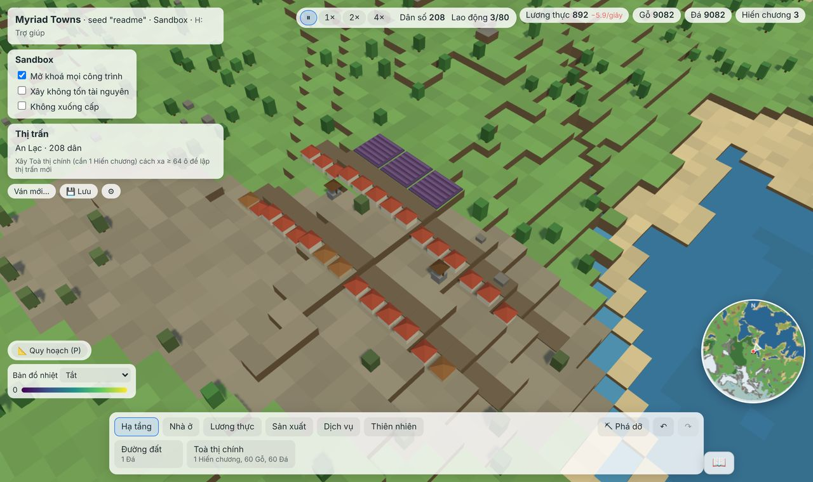
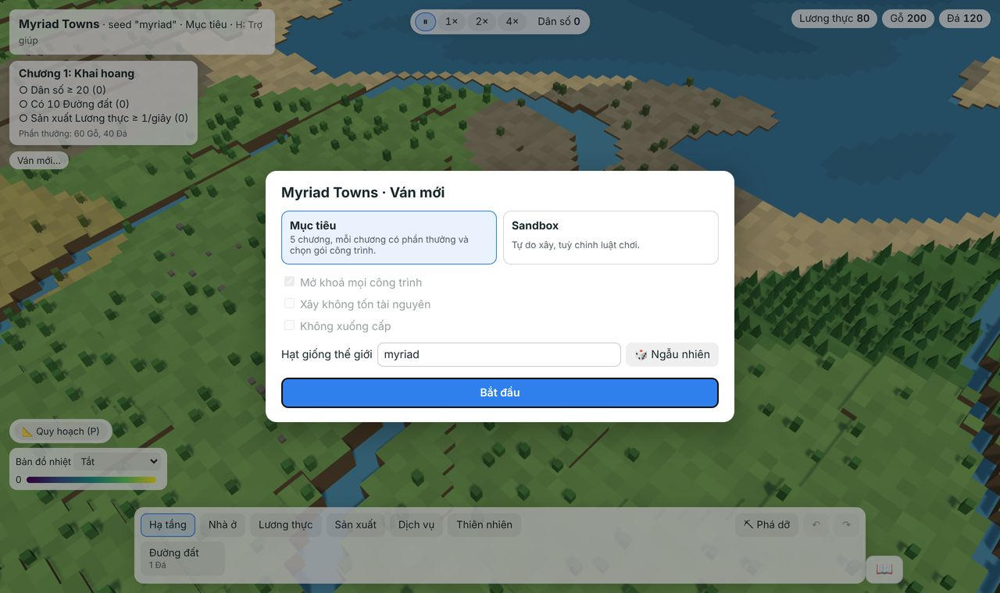
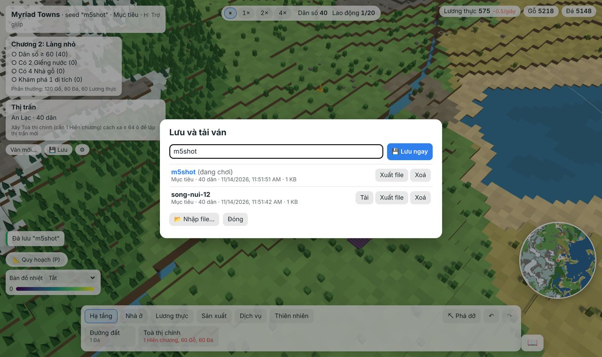
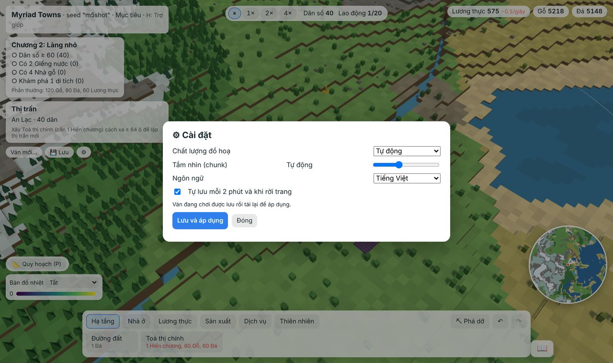
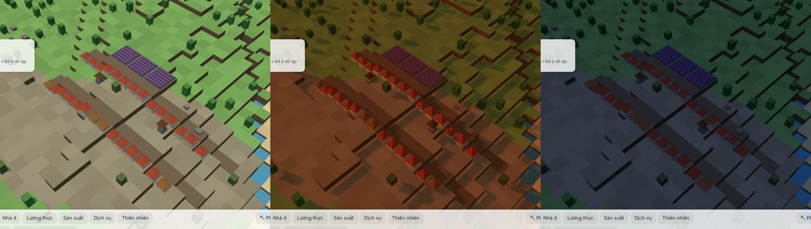
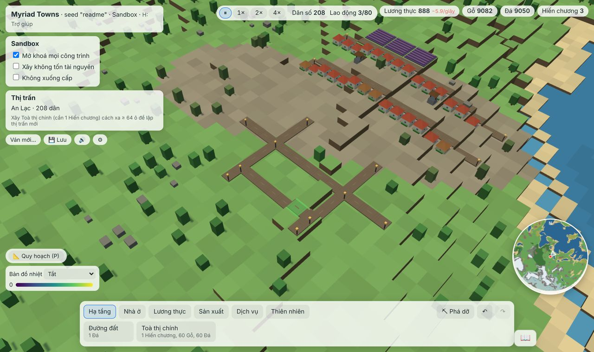
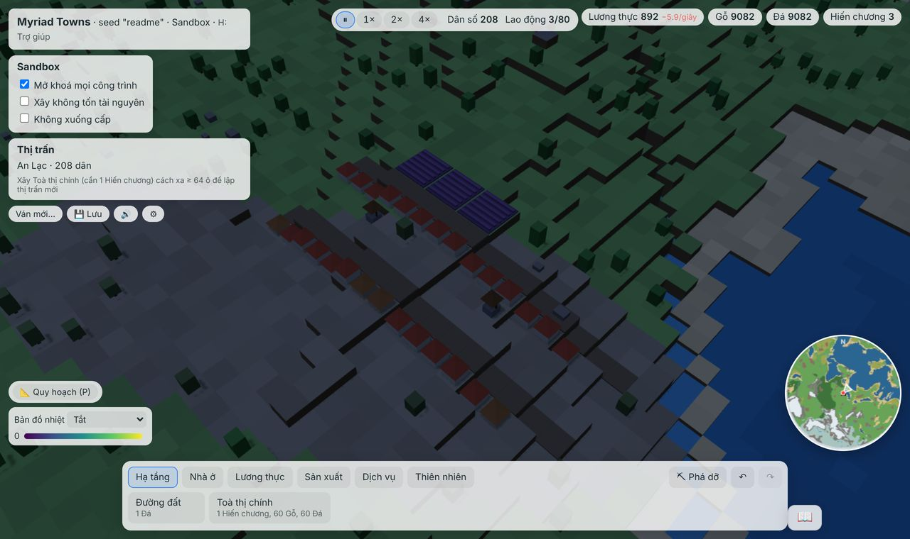
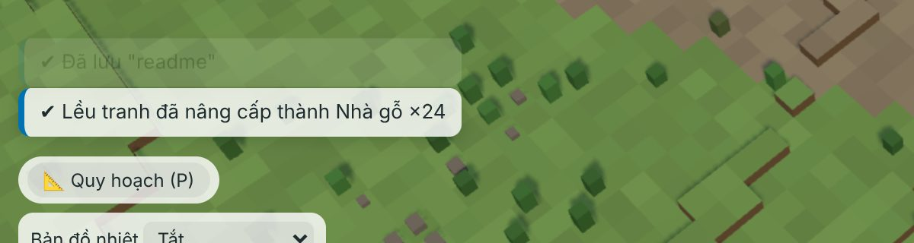

# Myriad Towns

Game city builder gốc chạy trên trình duyệt: thế giới sinh thủ tục vô hạn, công trình nâng cấp hoặc suy thoái theo
những gì nằm trong bán kính quanh nó. Chơi được trên máy (local) và deploy tĩnh lên GitHub Pages.

Chơi thử: https://ndlong1601.github.io/myriad-towns/



> Trạng thái: **M6 xong** (ngày đêm, âm thanh, đường tự nối, đèn đêm, bảng màu cho người mù màu). Tiếp theo: M7 (phát hành công khai, PWA). Lộ trình ở cuối trang.

## Có gì trong game

### Thế giới vô hạn và công trình sống theo láng giềng

Bản đồ sinh từ seed, đi mãi không hết: đồng cỏ, rừng, núi, thảo nguyên, vùng lạnh, bãi biển, phế tích. Mỗi công trình
tự nâng cấp khi đủ điều kiện xung quanh (ví dụ Lều tranh gần giếng thành Nhà gỗ) và xuống cấp nếu thiếu, luôn có cảnh
báo trước. Bấm vào một công trình để xem **"Vì sao?"**: nó cần gì, còn thiếu gì. Phím 1–0 bật **bản đồ nhiệt** để thấy
vùng phủ của nước, dịch vụ, ô nhiễm...


### Hai chế độ chơi

Màn hình ván mới cho chọn **Mục tiêu** hoặc **Sandbox**, nhập seed (hoặc 🎲 ngẫu nhiên), bật hướng dẫn cho người mới,
hoặc **Tiếp tục** ván gần nhất.



- **Mục tiêu**: 5 chương. Xong mỗi chương được thưởng tài nguyên, và từ chương 2 được **chọn 1 trong 2 gói công
  trình** (thương mại, thủ công, học thuật, tín ngưỡng, công nghiệp). Gói không chọn sẽ được đề xuất lại sau.
- **Sandbox**: mở khoá mọi công trình, xây miễn phí, tắt xuống cấp; bật tắt được ngay trong ván.


### Nhiều thị trấn

Công trình đầu tiên lập thị trấn thứ nhất. Mỗi thị trấn có **lãnh thổ** (đường viền trên mặt đất) lớn dần theo dân số;
ở chế độ Mục tiêu chỉ xây được trong lãnh thổ. Muốn mở rộng xa hơn thì xây **Toà thị chính** (cần 1 Hiến chương) cách
các thị trấn khác ít nhất 64 ô. Bảng Thị trấn ở cột trái cho bay tới từng nơi; thị trấn ở xa camera chỉ chạy tóm tắt
sản xuất cho nhẹ máy. **Di tích** vàng rải trên bản đồ: xây gần là khám phá được và nhận thưởng.


### Hướng dẫn cho người mới

Bảy bước ngắn ở cột trái (di chuyển, làm đường, đặt nhà, lương thực, giếng, xem "Vì sao?"), mỗi bước tự xong khi bạn
làm; bỏ qua được bất cứ lúc nào.


### Lưu ván và cài đặt

- **💾 Lưu** hoặc Ctrl+S; tự lưu mỗi 2 phút và khi rời tab. Đóng tab mở lại là chơi tiếp.
- Nhiều bản lưu trong trình duyệt; **xuất/nhập** file `.mtsave` để chuyển máy hoặc gửi bạn bè.
- **⚙ Cài đặt**: chất lượng đồ hoạ, tầm nhìn, ngôn ngữ (Tiếng Việt / English), âm lượng, ngày đêm, tự lưu.

| Lưu và tải                                  | Cài đặt                                   |
| ------------------------------------------- | ----------------------------------------- |
|  |  |

### Ngày đêm, âm thanh và cảm giác xây

- **Ngày đêm theo giờ trong game**: một ngày là 10 phút chơi ở tốc độ ×1, dừng game thì trời cũng dừng. Bình minh và hoàng hôn ngả cam, đêm xanh tối nhưng vẫn nhìn rõ công trình. Tắt trong ⚙ nếu muốn trời luôn sáng.
- **Âm thanh tự tổng hợp** (không tải file nào): tiếng "cộc" khi xây, tiếng sỏi khi kéo đường, tiếng đổ khi phá, chuông khi nâng cấp, hợp âm khi xong chương hay lập thị trấn, tiếng "bíp bíp" khi không đặt được.
- **Âm nền theo nơi camera nhìn**: chim hót ban ngày, dế kêu ban đêm, nước chảy gần sông hồ, tiếng ồn phố khi đông nhà, gió to hơn khi zoom xa.
- Nút **🔊/🔇** ở cột trái tắt tiếng (nhớ cho lần sau); âm lượng chỉnh trong ⚙ và nghe thử ngay khi kéo.
- Công trình mới **"nảy" lên** khi đặt và khi nâng cấp, thay vì hiện ra cứng đơ.



### Hạ tầng, đường nâng cấp và công nghiệp

- **Cầu gỗ và cầu đá** bắc qua sông hồ: đặt trên nước, phải nối với đường (cách tối đa 1 ô). Kéo chuột để làm một đoạn cầu liền.
- **Đường nâng cấp theo khu dân cư**: đường đất ở gần nhà gỗ tự lát đá, khu đông đúc (nhà phố, biệt thự) tự lát gạch. Mức "Đô thị hoá" là một bản đồ nhiệt mới (chọn trong ô Bản đồ nhiệt). Đường đá và đường lát gạch cũng xây tay được, đều tính là đường cho mọi điều kiện.
- **Tháp nước**: nước sạch phủ rộng hơn giếng.
- **6 công trình công nghiệp mới**: Hố sỏi, Trạm giao thương, Cối xay gió, Nhà máy điện, Xưởng đúc và Nhà máy. Chuỗi: quặng → lò nung → xưởng đúc (kim loại), điện từ cối xay gió hoặc nhà máy điện, rồi Nhà máy làm ra nhiều hàng hoá.
- **Dễ chơi hơn ở biome thiếu đá**: Hố sỏi xây ở bất cứ đâu và ra đá chậm; Trạm giao thương đổi lương thực lấy đá và gỗ; mỏ đá chỉ cần 1 ô đá thay vì 2; tài nguyên khởi đầu tăng (lương thực 150, gỗ 300, đá 200).


### Đường tự nối, đèn đêm và trang trí

- **Đường tự nối:** đường nhìn thấy láng giềng và tự đổi hình: đoạn thẳng có vạch giữa, góc, ngã ba, ngã tư, đường cụt. Phá một ô thì các ô quanh nó đổi lại ngay.
- **Đèn đường** ở ngã ba, ngã tư và đầu đường cụt.
- **Cửa sổ sáng đèn về đêm** trên nhà, toà nhà và hội trường. Công trình bị bỏ hoang thì tối om.
- **Nhà có vườn nhỏ:** hàng rào cây và mảng hoa.





### Bảng màu cho người mù màu

Bật trong ⚙ (hoặc `?palette=cvd`): xanh dương thay cho xanh lá, cam thay cho đỏ ở thông báo, ô đặt thử và số liệu tài nguyên. Mọi thông báo còn có ký hiệu đi kèm (✔ tốt, ▲ cảnh báo, ✖ xấu) nên không phụ thuộc vào màu.



### Chơi trên điện thoại

Giao diện tự xếp lại cho màn hình nhỏ; chạm để xây, hai ngón để zoom/xoay. Bản đồ nhỏ ẩn sẵn, mở bằng nút 🗺.


## Điều khiển

| Thao tác                              | Việc                                 |
| ------------------------------------- | ------------------------------------ |
| Kéo chuột trái / WASD / phím mũi tên  | Di chuyển (giữ Shift để nhanh)       |
| Kéo chuột phải                        | Xoay và nghiêng                      |
| Q / E                                 | Xoay 90°                             |
| R / F                                 | Nghiêng lên / xuống                  |
| Cuộn chuột                            | Zoom                                 |
| Cảm ứng: 1 ngón kéo, 2 ngón chụm/xoay | Di chuyển, zoom, xoay                |
| Space                                 | Tạm dừng / chạy tiếp                 |
| 1–9, 0                                | Bật/tắt bản đồ nhiệt một trường      |
| P                                     | Chế độ quy hoạch (bản nháp miễn phí) |
| X / Esc / Ctrl+Z / Ctrl+Y             | Phá / huỷ / hoàn tác / làm lại       |
| Bấm vào công trình                    | Xem trạng thái và "Vì sao?"          |
| M                                     | Bật/tắt bản đồ nhỏ                   |
| Ctrl+S                                | Lưu ván                              |

## Chạy trên máy (Windows / macOS / Linux)

Cần **Node.js 22** trở lên (https://nodejs.org).

```bash
npm install          # lần đầu
npm run dev          # mở http://localhost:5173
```

Tham số URL:

- `?seed=hanoi` đổi thế giới (cùng seed luôn ra cùng thế giới)
- `?speed=0|1|2|4` tốc độ lúc mở game, `?sandbox=1` mở khoá mọi công trình
- `&x=1000000&z=-500` bắt đầu tại ô bất kỳ
- `&r=4` bán kính hiển thị (chunk), giảm nếu máy yếu

## Lệnh thường dùng

| Lệnh                                                                      | Việc                                                           |
| ------------------------------------------------------------------------- | -------------------------------------------------------------- |
| `npm run dev`                                                             | Server phát triển, tự reload                                   |
| `npm run check`                                                           | Lint + typecheck + kiểm dữ liệu + unit test + build (giống CI) |
| `npm test`                                                                | Unit test (Vitest)                                             |
| `npx playwright install chromium` rồi `npm run build && npm run test:e2e` | Smoke test trên trình duyệt                                    |
| `npm run build` rồi `npm run preview`                                     | Thử bản production tại http://localhost:4173                   |

## Deploy lên GitHub Pages

1. Tạo repo trên GitHub (ví dụ `myriad-towns`) và push nhánh `main`.
2. Vào **Settings → Pages → Build and deployment → Source** chọn **GitHub Actions**.
3. Mỗi lần push lên `main`, workflow `deploy.yml` build và đăng tại `https://<tài-khoản>.github.io/myriad-towns/`.

## Làm việc với nhiều agent

Quy ước chung cho Claude Code và Antigravity nằm trong [AGENTS.md](AGENTS.md). Việc giao cho agent viết thành
task spec trong [docs/tasks/](docs/tasks/), bắt đầu từ [\_TEMPLATE.md](docs/tasks/_TEMPLATE.md).

## Lộ trình

| Mốc | Nội dung                                                                       | Trạng thái |
| --- | ------------------------------------------------------------------------------ | ---------- |
| M0  | Khung dự án, công cụ, CI                                                       | ✔          |
| M1  | Thế giới vô hạn theo chunk, camera                                             | ✔          |
| M2  | Đặt công trình, luật bán kính, hoàn tác                                        | ✔          |
| M3  | Kinh tế, mô phỏng, nâng cấp/xuống cấp, bản đồ nhiệt, quy hoạch                 | ✔          |
| M4  | Chế độ chơi, chương, gói công trình, biome, di tích, nhiều thị trấn, hướng dẫn | ✔          |
| M5  | Lưu/tải, tự lưu, xuất/nhập file, cài đặt                                       | ✔          |
| M6a | Ngày đêm, âm thanh tự tổng hợp, hiệu ứng xây, cài đặt âm lượng                 | ✔          |
| M6b | Đường tự nối, đèn đêm, nhà có vườn, bảng màu cho người mù màu                  | ✔          |
| M7  | Phát hành công khai, cài như ứng dụng (PWA), chơi offline                      | Tiếp theo  |

Chi tiết kỹ thuật: [docs/architecture.md](docs/architecture.md) và các ADR trong [docs/adr](docs/adr).

## Giấy phép

Mã nguồn: chưa chọn (xem `LICENSE` khi có). Asset bên thứ ba ghi trong `CREDITS.md`.
